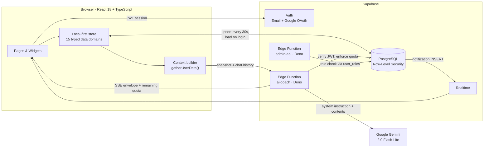
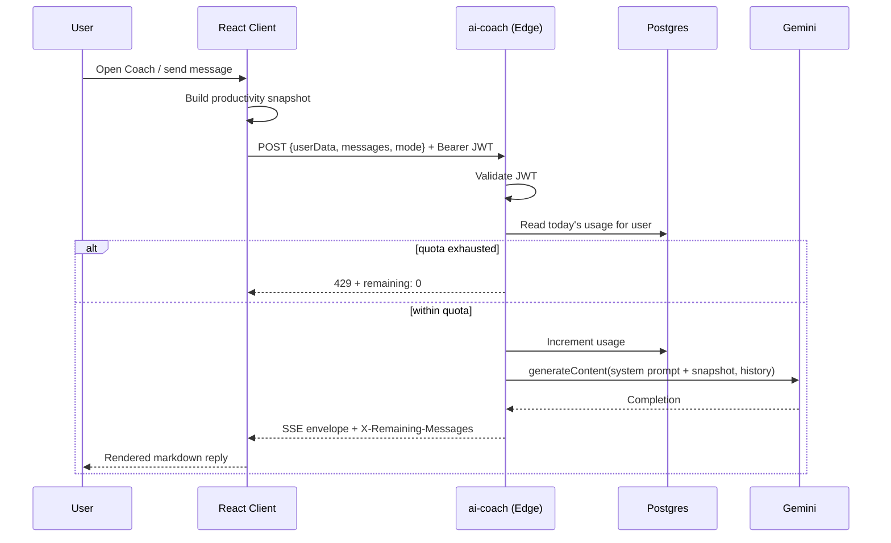

<div align="center">


# Haqqat: AI Productivity Coach

**A production productivity app with an LLM coach that reads your real data: routines, focus time, energy and goals. It gives specific advice instead of generic tips.**

[](https://haqqat.netlify.app/)
[](https://haqqat.netlify.app/)


[**Live app**](https://haqqat.netlify.app/) · [AI Coach design](#-the-ai-coach) · [Architecture](#-architecture) · [Engineering decisions](#-engineering-decisions) · [Run locally](#-run-locally)

</div>

---

## Why Haqqat exists

Most productivity apps store data and stop there. Most AI assistants know nothing about you. Haqqat connects the two.

You log routines, tasks, focus sessions, energy levels, decisions and procrastination triggers. Haqqat turns that data into a compact context snapshot, and **Hadi**, the AI coach, uses it to give specific advice. For example: *"You did 40 min of deep work today and have 3 overdue tasks. Your energy peaks at 10am, so block that hour for the hardest one."*

> **It's live and in use.** Haqqat runs in production at **[haqqat.netlify.app](https://haqqat.netlify.app/)**, a small group of real users has tried it, and I use it every day to plan my own work.

<table>
<tr>
<td width="33%" valign="top">

**🧠 Context-aware LLM coaching**<br/>
Each prompt is built from the user's live behavioral data. Two modes: a structured daily briefing and multi-turn chat.

</td>
<td width="33%" valign="top">

**🛡️ Production guardrails**<br/>
Server-side JWT checks, per-user daily quotas stored in Postgres, and handling for upstream 429s. The API key never reaches the browser.

</td>
<td width="33%" valign="top">

**⚡ Local-first, cloud-synced**<br/>
The UI reads from local storage, so it responds instantly. Data syncs in the background to Postgres, isolated per user by Row-Level Security.

</td>
</tr>
</table>

---

## 🤖 The AI Coach

The coach is a **Supabase Edge Function** (Deno) that sits between the client and **Google Gemini 2.0 Flash-Lite**. The interesting work is in what the model receives and the controls around each call.

### 1. Context engineering: grounding the model in real data

Before each request, the client builds a small, structured snapshot from 15 local data stores. It doesn't send raw history:

| Signal | What the model sees |
|---|---|
| Execution | Routines completed today, tasks finished, focus minutes, today's XP |
| Risk | Overdue tasks, tasks due in the next 3 days |
| Composite | A **daily productivity score** (0–100), weighted across routines 30%, tasks 30%, focus 25% and an overdue penalty 15% |
| Behavior | Main triggers from the last 5 procrastination entries, today's average energy |
| Direction | Active goals with milestone progress and priority |

The snapshot goes into the **system instruction**, so the model treats it as ground truth. Chat history stays clean.

### 2. Prompt design with two modes

- **Coaching mode**: a fixed response structure of **Quick Win → Focus Areas → Today's Challenge**, capped at about 400 words, that must cite the user's actual numbers.
- **Chat mode**: multi-turn follow-ups capped at about 200 words. The function maps message roles from the client's `assistant`/`user` format to Gemini's `model`/`user` format.
- The persona is "supportive but direct": it celebrates wins briefly and states clearly what needs work. Sampling is `temperature 0.7`, `maxOutputTokens 1024`.

### 3. Cost and abuse controls on the server

```
Request ─▶ Verify JWT ─▶ Check ai_coach_usage (user, date) ─▶ Increment ─▶ Call Gemini ─▶ Respond
                │                    │
                └── 401              └── 429 "Daily limit reached" (10 msgs/user/day)
```

- The quota lives in **Postgres**, not the browser, so clearing local storage or calling the API directly doesn't bypass it.
- The remaining quota comes back in an `X-Remaining-Messages` header, and the UI shows it live.
- Gemini's own `429`s are mapped to a friendly retry message. Other upstream errors are logged on the server and returned as clean JSON errors.
- Admins can **reset a user's quota** from the admin console. The user then gets a **realtime notification** through Supabase Realtime.

### 4. Provider-agnostic response envelope

The Edge Function wraps Gemini's reply in an **OpenAI-style SSE `delta` envelope** (`data: {...}` followed by `data: [DONE]`). The frontend's stream reader only understands that one format, so **the model provider can change without any client changes.** I switched LLM providers in production without touching the UI.

### 5. Deterministic insights alongside the LLM

Not every insight needs a model call. The **Insights** page runs a rule-based engine for overdue load, stalled goals, slipping streaks, low-value tasks and focus deficits. It costs nothing, has no latency and is always available. The LLM handles the questions that need reasoning.

---

## ✨ Product features

| Area | What it does |
|---|---|
| 🌅 **Morning Ritual** | Guided daily start: energy check-in → reflection → intention → top priorities → time blocks |
| ✅ **Tasks** | Priorities, deadlines, and an automatic **Eisenhower matrix** (urgent × important) |
| 🎯 **Goals** | Goals broken into milestones, with progress tracking |
| 🔁 **Routines** | Habit tracking with per-routine **streaks** and **7-day completion rates** |
| ⏱️ **Focus** | Configurable Pomodoro timer; sessions feed analytics and XP |
| ⚡ **Energy Map** | Hourly energy logs combined into a **"biological prime time"** map that labels each hour as best for deep work, creative work, admin, social or rest |
| 🧭 **Decision Journal** | Records decisions with expected outcomes and tracks **decision accuracy** over time |
| 🔍 **Procrastination Autopsy** | Logs *why* a task was delayed and shows recurring trigger patterns |
| ✉️ **Future Letters** | Time-locked letters to your future self |
| ⚖️ **Life Balance** | Radar chart of life areas, built from actual activity data |
| 📝 **Weekly Reviews** | Structured weekly reflection |
| 📊 **Analytics & Insights** | Trends, a productivity score and rule-based recommendations |
| 🎮 **Gamification** | XP for every meaningful action, increasing level thresholds (level *N* needs *N × 100* XP), streaks, achievements, daily and weekly challenges, personal records, confetti and XP toasts |
| 🛠️ **Admin console** | Role-gated: user management, plan and role changes, AI-quota resets with a gift message, ban/unban, usage analytics |
| 🔐 **Auth** | Email/password and Google OAuth, password reset, guided onboarding |
| 🌗 **Themes** | Light and dark themes, responsive layout with a swipe-to-close mobile nav |

---

## 🏗 Architecture



### Request lifecycle: one coaching message



### Data and security model

- **Every table has RLS enabled**: `profiles`, `user_roles`, `subscriptions`, `user_data`, `ai_coach_usage`. Users can only read or write rows where `auth.uid() = user_id`.
- **Database triggers** create a profile and a subscription row whenever a new auth user signs up, and keep `updated_at` current. This bootstrapping can't be skipped by the client.
- **Role-based access** uses a Postgres `app_role` enum and a `has_role()` function. Admin actions run only inside an Edge Function that checks the caller's role first.
- **The service-role key is used only in Edge Functions.** The browser holds only the public anon key.
- **User data** is stored as JSONB documents keyed by `(user_id, data_key)`, so adding a new feature domain doesn't require a schema migration.

---

## 🧩 Engineering decisions

| Decision | Why | Trade-off I accepted |
|---|---|---|
| **Edge Functions instead of a Node/Express server** | No server to run, scales automatically, and secrets stay on the server | Deno runtime constraints; logic is split across two small functions |
| **Local-first store + background sync** | Instant UI with no loading spinners, and it keeps working on a weak network | Last-write-wins sync; conflict resolution is on the roadmap |
| **JSONB key-value storage for user data** | New feature domains need no migrations, which suited a fast-changing product | Less relational querying across domains |
| **Quota enforced in Postgres** | LLM spend stays predictable and can't be bypassed from the client | One extra DB round-trip per AI call |
| **Non-streaming LLM call in an SSE envelope** | More reliable in the edge runtime, and the client stays independent of the provider | Users wait for the full reply instead of seeing tokens arrive |
| **Rule engine + LLM hybrid** | Common insights cost nothing; the model is used only where reasoning helps | Rules need to be maintained by hand |
| **Small, fast model (Flash-Lite)** | Low latency and low cost per message for short coaching replies | Less depth than larger models |

---

## 🛠 Tech stack

| Layer | Technology |
|---|---|
| **Frontend** | React 18, TypeScript, Vite, React Router, TanStack Query |
| **UI** | Tailwind CSS, Radix UI primitives / shadcn/ui, Framer Motion, Recharts, Lucide |
| **AI** | Google Gemini 2.0 Flash-Lite via REST, prompt + context engineering |
| **Backend** | Supabase: Postgres, Auth, Realtime, Edge Functions (Deno) |
| **Security** | Row-Level Security, JWT verification, role-based admin API, server-side quotas |
| **Hosting** | Netlify (SPA) + Supabase Cloud |
| **Tooling** | ESLint, Vitest, Testing Library |
| **Analytics/SEO** | Google Analytics 4, Open Graph / Twitter cards, Search Console |

---

## 📁 Project structure

```
├── src/
│   ├── pages/                 # 25 route-level screens (Dashboard, Focus, EnergyMap, Admin, ...)
│   ├── components/            # AICoachWidget, XP/confetti layers, navigation, ProGate, ...
│   │   └── ui/                # Accessible Radix-based primitives
│   ├── lib/
│   │   ├── store.ts           # Typed local-first store, scoring, XP & streak engine
│   │   └── cloudSync.ts       # Postgres sync (upsert / hydrate)
│   ├── contexts/              # Auth & subscription providers
│   ├── hooks/                 # useXP, useNotifications (realtime), useProfile, ...
│   └── integrations/supabase/ # Typed DB client
└── supabase/
    ├── functions/
    │   ├── ai-coach/          # LLM gateway: auth, quota, prompt, Gemini call
    │   └── admin-api/         # Role-gated admin operations
    └── migrations/            # Schema, RLS policies, triggers, roles
```

---

## 🚀 Run locally

**Prerequisites:** Node.js 18+, a free [Supabase](https://supabase.com) project, and a [Google AI Studio](https://aistudio.google.com/apikey) API key.

```bash
# 1. Clone and install
git clone https://github.com/rafrafreza/haqqat-ai-productivity-coach.git
cd haqqat-ai-productivity-coach
npm install

# 2. Configure environment
cp .env.example .env   # add your Supabase URL, anon key and project ref

# 3. Database: apply the SQL in supabase/migrations/ (SQL editor or `supabase db push`)

# 4. Deploy the edge functions and set the model key
supabase functions deploy ai-coach
supabase functions deploy admin-api
supabase secrets set GEMINI_API_KEY=your_key

# 5. Start the app
npm run dev
```

> Both Edge Functions verify the caller's JWT themselves, so gateway-level JWT verification can be turned off for them.

| Script | Purpose |
|---|---|
| `npm run dev` | Start the dev server |
| `npm run build` | Production build |
| `npm run lint` | Lint the codebase |
| `npm test` | Run the Vitest suite |

---

## 🗺 Roadmap

- [ ] **Token streaming** with `streamGenerateContent` so replies start appearing immediately
- [ ] **Long-term coach memory**: embed journal, decision and review entries with **pgvector** so the coach can retrieve past patterns (RAG)
- [ ] **Prompt evaluation harness**: fixed user snapshots plus rubric-based scoring to catch quality regressions when prompts or models change
- [ ] **Tool calling**: let the coach create tasks, schedule focus blocks or adjust routines directly
- [ ] **Conflict-aware sync** using per-record timestamps instead of last-write-wins
- [ ] Installable **PWA** with offline support and push reminders

---

<div align="center">

### Built by [Rafraf Reza](https://github.com/rafrafreza)

I design, build and ship AI-powered products end to end: LLM integration, backend, security and UI.<br/>
**Open to AI Engineer / GenAI Engineer / Software Engineer roles**: remote worldwide, or hybrid/on-site in India.

[**Try Haqqat live →**](https://haqqat.netlify.app/) · [More of my work](https://github.com/rafrafreza)

</div>
